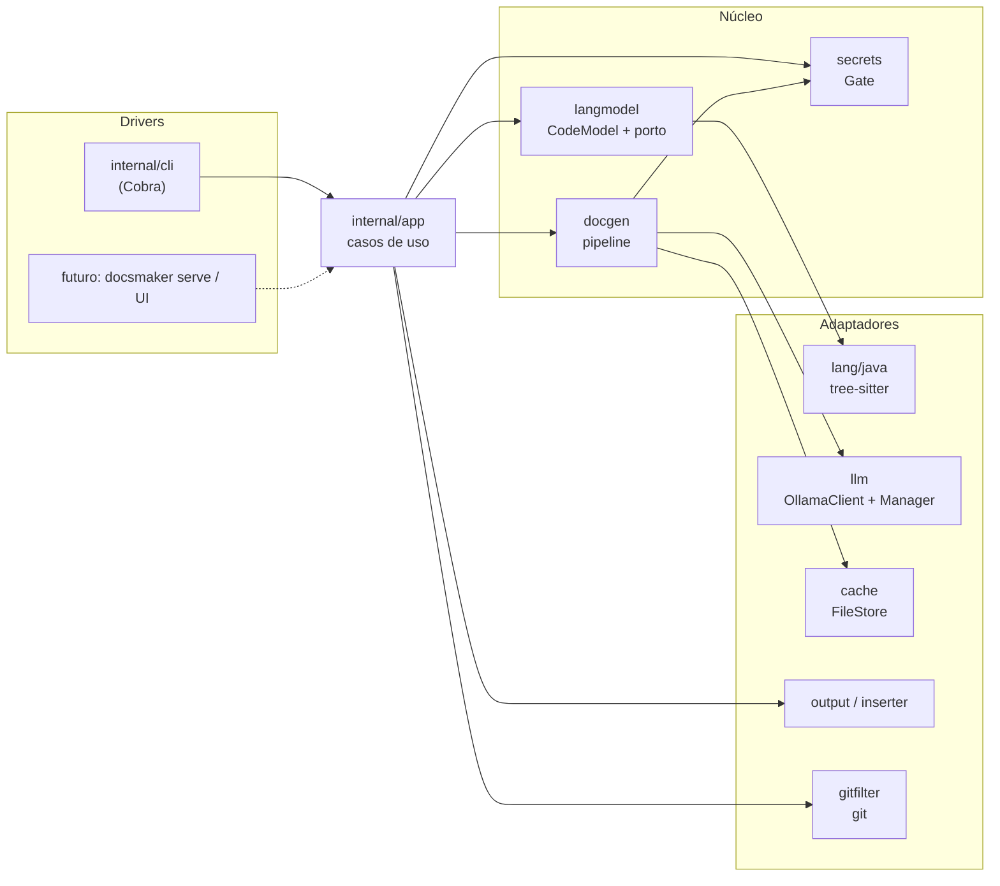
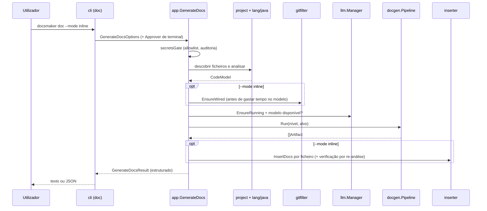

# 1. Arquitetura

## Estilo: hexagonal (portos e adaptadores)

O núcleo (análise, geração, segurança) depende apenas de **interfaces**
("portos"). Tudo o que toca no exterior (terminal, Ollama, sistema de ficheiros,
git, tree-sitter) é um **adaptador** que implementa um porto. A camada
`internal/app` liga as peças e é a **única fronteira** entre quem pede coisas
(drivers: hoje o Cobra CLI) e o núcleo.



Regra de ouro: **`internal/cli` não contém lógica**. Faz parse de flags, chama
`internal/app` e formata o resultado. `internal/app` devolve sempre **dados
estruturados** (nunca texto já formatado), por isso um segundo driver (um
servidor HTTP local, uma UI) reutiliza tudo sem mexer no núcleo
(ver [Extensibilidade](07-extensibilidade.md)).

## Pacotes

| Pacote | Responsabilidade | Porto que define / implementa |
|--------|------------------|-------------------------------|
| `cmd/docsmaker` | `main`; importa `lang/java` (efeito: regista o analisador) | |
| `internal/cli` | Comandos Cobra: `analyze`, `doc`, `rules`, `init`, `model`, `allowlist`, e o oculto `git-clean-filter` | driver |
| `internal/app` | Casos de uso: `Analyze`, `GenerateDocs`, `ExtractRules`, `Init`, `ModelStatus/List/Pull`, `Allowlist*`; orquestra o modo inline | fronteira |
| `internal/langmodel` | IR independente da linguagem (`CodeModel`) e o porto `LanguageAnalyzer` + registo | **`LanguageAnalyzer`** |
| `internal/lang/java` | Analisador de Java com tree-sitter | implementa `LanguageAnalyzer` |
| `internal/project` | Descoberta de ficheiros (respeita `.gitignore`), deteção de Maven/Gradle e nome do projeto | |
| `internal/docgen` | Pipeline de sumarização hierárquica e construção do README; extração de regras (`ExtractRules`) e o seu relatório | usa `llm.Client`, `cache.Store`, `secrets.Gate` |
| `internal/rules` | Tipo `Rule`, seleção de métodos candidatos, leitura tolerante da resposta do modelo e verificação de evidência (ver [capítulo 10](10-extracao-de-regras.md)) | dados e funções puras |
| `internal/llm` | Cliente do modelo; `Manager` (instalar/arrancar/listar/descarregar); guardas de "só local" | **`Client`**; implementa-o com `OllamaClient` |
| `internal/llm/prompts` | Montagem pura dos prompts por nível | |
| `internal/cache` | Cache por hash do pedido | **`Store`**; `FileStore` |
| `internal/secrets` | Deteção (regex + entropia), redação, decisões, auditoria, allowlist | **`Scanner`**, **`Approver`**, `AuditLog`, `Allowlist` |
| `internal/output` | Escrita de resultados em ficheiros à parte | **`Writer`**; `SidecarWriter` |
| `internal/inserter` | Inserção de comentários nos fontes | **`Inserter`**; `BlockCommentInserter` |
| `internal/gitfilter` | Marcas, filtro `clean`/`smudge`, configuração do git, verificação | |

Nota: o porto `output.Writer` existe e `SidecarWriter` implementa-o, mas o
modo `console` não passa por ele; a consola é renderizada no `internal/cli`
a partir do resultado estruturado.

## Fluxo de `docsmaker doc`



Ordem importa: verificações baratas e que protegem o utilizador (filtro git,
disponibilidade do modelo local) acontecem **antes** das chamadas lentas ao modelo.

## Portos, em detalhe

```go
// langmodel: um analisador por linguagem
type LanguageAnalyzer interface {
    Language() string
    FileExtensions() []string
    ParseProject(ctx, files []string) (*CodeModel, []Diagnostic, error)
}

// llm: o único adaptador é o Ollama, de propósito
type Client interface {
    Generate(ctx, Request) (Response, error)
    Available(ctx) bool
}

// secrets: quem decide o que fazer a um achado (terminal hoje, modal amanhã)
type Approver interface { Resolve(ctx, Finding) (Decision, error) }
type Scanner  interface { Scan(text string) []Finding }
type Allowlist interface { Allows(value string) bool; Add(kind, value, where string) error }

// cache e inserter
type Store    interface { Get(key) (string, bool); Set(key, value string) error }
type Inserter interface { InsertDocs(ctx, file string, []Insertion) ([]Outcome, error) }
```

**Não existe, por desenho, um `Client` remoto.** A garantia "o código não sai
da máquina" é imposta pelo que não existe no código, não por uma flag em tempo
de execução (ver [Segurança](04-seguranca-e-segredos.md)).

## Dependências externas

| Dependência | Uso |
|-------------|-----|
| `github.com/spf13/cobra` | CLI |
| `github.com/smacker/go-tree-sitter` (+ gramática Java) | Análise sintática (usa **CGo**) |
| `github.com/sabhiram/go-gitignore` | Respeitar `.gitignore` na descoberta de ficheiros |

Todo o resto é biblioteca padrão do Go. Em tempo de execução, o `git` e o
`ollama` são programas externos invocados (o primeiro só em `init`/`inline`).
