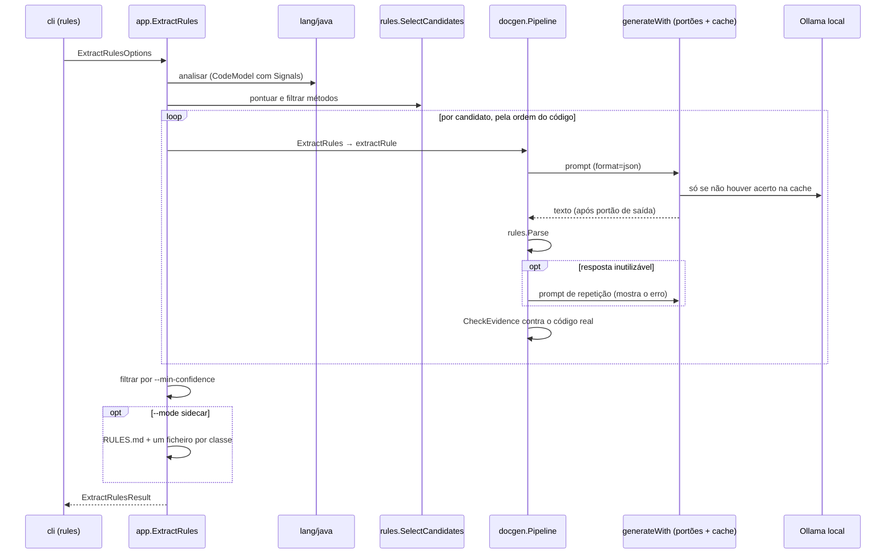

# 10. Extração de regras de negócio

Comando `docsmaker rules`. Complementa a documentação técnica (que diz *o que*
o código faz) com uma explicação, em linguagem natural, da *regra de negócio*
que um método implementa. Reutiliza a base existente: o `CodeModel`, o funil
`generate` (portões de segredos + cache), o cliente Ollama local, o
`SidecarWriter` e a camada `app`. O que é novo está resumido na tabela.

| Peça | Ficheiro | Novo ou alterado |
|------|----------|------------------|
| Sinais estruturais de um método | `langmodel/codemodel.go` (`Signals`), `lang/java/symbols.go` (`computeSignals`) | alterado |
| Tipo `Rule`, confiança, ID estável | `rules/rule.go` | novo |
| Seleção de candidatos | `rules/select.go` | novo |
| Leitura tolerante da resposta + verificação de evidência | `rules/parse.go` | novo |
| Prompt e prompt de repetição | `llm/prompts/rules.go` | novo |
| Formato de saída do pedido (`json`) | `llm/client.go`, `llm/ollama.go` | alterado |
| Orquestração por método | `docgen/rules.go` (`Pipeline.ExtractRules`) | novo |
| Opções de geração (formato, `accept`) | `docgen/pipeline.go` (`generateWith`) | alterado |
| Relatório Markdown | `docgen/rulescatalog.go` | novo |
| Caso de uso e saída sidecar | `app/rules.go` | novo |
| Comando | `cli/rules.go`, registo em `cli/root.go` | novo |

## Fluxo



## 1. Seleção de candidatos

Chamar o modelo em todos os métodos seria lento (pedidos sequenciais) e
encheria o relatório de ruído. O analisador mede cada corpo de método e guarda
um `Signals` em `Method.Signals` (nulo se o método não tem corpo):

| Sinal | Conta |
|-------|-------|
| `Statements` | instruções (`*_statement`) e declarações locais |
| `Branches` | `if` (um `else if` é um `if` aninhado, logo conta), `? :` e cada `case` de um `switch` (o `default` não conta) |
| `Throws` | `throw` explícitos: a forma habitual de uma validação |
| `Comparisons` | `< > <= >= == !=` e chamadas `equals`, `equalsIgnoreCase`, `compareTo`, `matches` |
| `Literals` | números diferentes de 0 e 1 (em qualquer grafia: `0L`, `1.0f`, `0.`) e textos não vazios |

`rules.Score` = `2·Branches + 2·Throws + Comparisons + Literals`; o mínimo por
omissão é `DefaultMinScore = 3`. `SelectCandidates` filtra por âmbito
(`Scope`: pacote, `pkg.Type` ou `pkg.Type#método`), por pontuação e, com
`MaxMethods`, fica com os N mais pontuados (desempate pela ordem do código) e
devolve-os **pela ordem do código**, para o resultado ser estável.

Os sinais vivem no `CodeModel` (e portanto no `analyze --format json`) em vez de
serem calculados por `docgen`: o resto do sistema não sabe nada de tree-sitter
nem de sintaxe Java (ver [Arquitetura](01-arquitetura.md)). Um analisador de
outra linguagem só tem de preencher o mesmo `Signals`.

## 2. O contrato com o modelo

O *system prompt* (inglês, `prompts.BusinessRules`) pede **um único objeto
JSON**:

```json
{"hasRule": true, "statement": "...", "conditions": ["..."],
 "rationale": "...", "evidence": ["..."],
 "confidence": "high|medium|low", "openQuestions": ["..."]}
```

ou `{"hasRule": false}`. Pontos de desenho:

- **O "porquê" é pedido como hipótese** (`rationale` começa por "Probably…" ou
  equivalente) e a **evidência tem de ser copiada do código**.
- Inclui um exemplo de um domínio diferente (portes de envio) para não
  contaminar respostas sobre faturação.
- O idioma das partes livres vem de `--output-lang`; os valores de campos como
  `confidence` ficam em inglês no contrato. O idioma entra no *system prompt*,
  portanto na chave de cache.
- O pedido leva `format: "json"` (`llm.Request.Format` → campo `format` do
  `/api/generate`). Isto força JSON **sintaticamente** válido, não a forma
  certa: a forma é verificada por `rules.Parse`.
- O *user prompt* inclui classe, assinatura, declarações dos campos da classe
  (máximo 30, pela ordem de declaração), o `ExistingDoc` e o código do método.
  Tem de ser determinístico, como todos os prompts (é chave de cache).

## 3. Ler e desconfiar da resposta

Modelos locais pequenos são desleixados, por isso `rules.Parse` aceita o que uma
pessoa sensata aceitaria: JSON dentro de prosa ou de cercas de código (extrai o
primeiro objeto completo, respeitando chavetas dentro de textos), um `NONE`
solto, listas escritas como um só texto, números em listas, `hasRule` como
texto, `hasRule` em falta quando há `statement`, e confiança em português.
Recusa, com uma mensagem que serve de explicação ao modelo: resposta vazia, sem
JSON, JSON cortado, JSON inválido, `hasRule: true` sem `statement`.

Depois de interpretada, a regra é verificada contra o código real
(`Rule.CheckEvidence`):

- uma linha de evidência só fica se existir no código do método (ignorando
  diferenças de espaços); as outras são removidas e contadas em
  `RuleResult.EvidenceDropped`;
- se **não sobrar nenhuma** evidência, a confiança é limitada a `low`, seja qual
  for a que o modelo declarou. Isto é a defesa principal contra uma regra
  inventada apresentada com autoconfiança.

`Rule.Normalize` apara textos, remove entradas vazias e transforma uma
confiança em falta ou desconhecida em `low` (uma resposta incerta nunca pode
parecer segura).

## 4. Pipeline: `Pipeline.ExtractRules`

Vive em `docgen` para chamar o funil de geração. Por candidato, em
`extractRule`:

1. lê o código do método (`readSpan`); se falhar → `failed`, e continua;
2. monta o prompt e chama `generateWith` com `format=json`;
3. se a resposta for `OmittedSummary` (o utilizador saltou o achado) → `omitted`;
4. `Parse`; se falhar, **uma** repetição com `prompts.BusinessRulesRetry`
   (mostra o problema e a resposta falhada); se voltar a falhar → `failed`
   com o motivo, e o resto do projeto continua;
5. `hasRule: false` → `none`; caso contrário `Rule` + `CheckEvidence` →
   `rule`.

Só interrompem a execução os erros em que continuar não faz sentido: modelo
inacessível, abandono (`q`) ou bloqueio num portão de segredos, e o
cancelamento do contexto. Nesses casos devolve-se o que já estava feito,
juntamente com o erro.

### `generate` → `generateWith`

`generate` passou a ser um invólucro de `generateWith(…, genOptions{format,
accept})`; o resto do fluxo (portão 1 → cache → modelo → portão 2 → cache) é o
descrito em [Pipeline de documentação](02-pipeline-de-documentacao.md). Duas
adições, ambas inócuas para os níveis de documentação:

- **`format`** vai no pedido e entra na chave de cache **apenas quando está
  definido**, para as entradas de cache existentes continuarem válidas.
- **`accept`** (aqui, `rules.Parse`) julga a resposta crua do modelo:
  - uma resposta rejeitada **nunca é escrita na cache**;
  - uma entrada de cache rejeitada é **ignorada** (volta a perguntar-se ao modelo).

  Sem isto, um JSON mal formado ficaria na cache e seria devolvido, sempre igual,
  em todas as execuções. Há um teste para cada metade da regra (e foram
  verificados com mutantes: remover qualquer uma das guardas faz um teste falhar).

A repetição usa um *user prompt* diferente, por isso tem a sua própria chave: a
resposta boa da repetição fica em cache, a má resposta inicial não. Numa segunda
execução repete-se a primeira tentativa (uma chamada) e a repetição vem da cache.

## 5. Segurança

Nada de novo: tudo passa pelo mesmo funil, logo pelos dois portões, pela
allowlist e pelo registo de auditoria (`where` identifica o método). O que é
específico:

- as **declarações dos campos** vão no prompt de cada método (é onde costumam
  estar constantes e credenciais), por isso são verificadas pelo portão 1;
- o portão 2 corre sobre o JSON; uma redação substitui o valor por um marcador
  `[REDACTED:…]` e, se alguma vez estragasse o JSON, o `Parse` seguinte falharia
  e entraria a repetição. Evidência redigida deixa de coincidir com o código e
  é descartada pela verificação acima;
- o `rules` nunca escreve nas fontes: só consola e `.docsmaker/rules/`.

## 6. Resultado, relatório e saída

`RuleResult` (JSON estável): `id`, `target`, `range`, `score`, `status`
(`rule|none|omitted|failed`), `rule`, `reason`, `evidenceDropped`.
`ExtractRulesResult`: `project`, `lang`, `results`, `summary`
(`found/none/omitted/failed/classes`), `hiddenByConfidence`, `outputDir`.

O `ID` de uma regra é `pkg.Type#método@L<linha>`. Inclui a linha inicial porque
`Target` não distingue sobrecargas.

`--min-confidence` filtra em `app` (não em `docgen`): as regras escondidas
contam-se em `hiddenByConfidence` e não entram no resumo.

O relatório (`docgen.BuildRulesCatalog`) é uma função pura dos resultados:
cabeçalho com aviso de que o "porquê" é inferido, resumo, uma secção por classe
com regras (pela ordem de primeira aparição), e a secção de métodos sem
resultado. Os rótulos estão em pt-PT por omissão e em inglês para qualquer outro
idioma. `--mode sidecar` usa o `SidecarWriter` existente com nível vazio:
`.docsmaker/rules/RULES.md` e `<pacote.Classe>.md` por classe com regras.

## 7. Testes

| Onde | O que cobre |
|------|-------------|
| `lang/java/analyzer_test.go` | Contagem exata dos sinais (getter, método abstrato, `if`/`else if`/ternário/`throw`, `switch`, ciclo com 0 e 1) |
| `rules/select_test.go`, `rules/fixture_test.go` | Pontuação, filtros, desempate, âmbito; sobre a fixture real, escolhe **exatamente** as 5 regras plantadas e nenhum getter |
| `rules/parse_test.go`, `rules/rule_test.go` | Respostas bem e mal formadas, coerção de campos, erros reutilizáveis, evidência inventada, IDs, gabarito vs fixture |
| `llm/prompts/prompts_test.go`, `llm/ollama_test.go` | Conteúdo, determinismo, idioma, repetição; `format` só enviado quando definido |
| `docgen/rules_test.go` | Regra encontrada, getter ignorado, repetição, falha isolada, cache (as duas guardas), erro do modelo, cancelamento, portões (redigir, saltar, bloquear, saída) |
| `docgen/rulescatalog_test.go` | Relatório em pt/en, agrupamento, determinismo, ficheiro por classe |
| `cli/rules_test.go` | Ponta a ponta contra um Ollama falso: relatório, JSON, `--min-confidence`, sidecar sem tocar nas fontes, cache, validação, segredos |

A fixture é `testdata/sample-project/.../billing/` (5 regras plantadas, mais uma
classe só com getters) e o gabarito `testdata/billing-expected-rules.json`
(palavras-chave que uma explicação correta deve mencionar). Um teste garante que
o gabarito e os fontes não divergem.

## 8. Decisões

| # | Decisão | Alternativas | Razão |
|---|---------|--------------|-------|
| 1 | **Comando novo** `rules`, não um nível de `doc` | `doc --level rules` | A saída é de outra natureza (regras com confiança e evidência, não texto corrido) e tem opções próprias |
| 2 | **Sem modo inline** | Bloco `@businessRule` no Javadoc | Uma hipótese de IA dentro do código tem mais risco e menos revisão; o relatório não toca nas fontes |
| 3 | **Sinais no analisador** (`Method.Signals`) | Heurística de texto sobre o código | Coerente com a arquitetura; não depende da sintaxe de uma linguagem fora de `lang/*` |
| 4 | **JSON com `hasRule`** em vez de `NONE` | Texto livre | Com `format: json` um `NONE` solto seria inválido; o parser aceita ambos |
| 5 | **Confiança limitada pela evidência verificada** | Confiar na confiança do modelo | Modelos pequenos declaram "alta" com facilidade |
| 6 | **Uma regra por método** | Lista de regras por método | Simplifica o contrato com modelos pequenos; as condições ficam listadas |
| 7 | **Não guardar respostas inutilizáveis na cache** | Guardar tudo | Evita repetir para sempre uma resposta má |
| 8 | **Uma repetição**, não várias | Sem repetição / loop | Custa uma chamada por falha e recupera a maioria dos erros de formato; mais seria lento |
| 9 | **ID com a linha** | Só o nome | Sobrecargas partilham o nome |

## 9. Limitações

- **A qualidade ainda não foi medida com um modelo real.** Os testes
  automáticos usam um modelo falso e provam o encanamento, as defesas e o
  formato, não a qualidade do texto. A avaliação contra o gabarito está planeada
  como passo à parte e será registada aqui.
- Cada método é visto isoladamente: nem chamadas entre métodos, nem constantes
  de outras classes, nem a base de dados.
- A pontuação é uma heurística: um método com regras expressas só por chamadas
  (por exemplo `politica.valida(x)`) pontua baixo e fica de fora.
- Só Java. A verificação de evidência é textual (ignora espaços), por isso
  evidência reformatada pelo modelo é descartada.
- Chamadas sequenciais: o tempo cresce linearmente com o número de candidatos.
  Usa `--max-methods` e `--target` para controlar.
- Ficheiros de classes de execuções anteriores não são apagados do sidecar.

## 10. Ideias seguintes

1. Medir a qualidade com vários modelos e registar a tabela (gabarito já existe).
2. Usar o histórico git (mensagens de commit do método) como pista para o
   "porquê", sempre como contexto, nunca como facto.
3. Consolidar as regras ao nível do projeto (agrupar duplicados, detetar
   contradições).
4. Passar chamadas resolvidas (`CallsOut`) e constantes de outras classes como
   contexto adicional.
5. Um segundo analisador que preencha `Signals`, para provar a extensibilidade.
